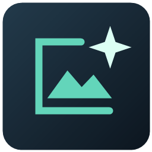

# Local Image Studio v2.0.0



Windows向けのシンプルなローカル画像生成UI。モデルを選び、プロンプトを入力して生成できます。
推論には [stable-diffusion.cpp](https://github.com/leejet/stable-diffusion.cpp) を使用します。
**Windows + NVIDIA CUDA向けです。モデル・推論エンジンは同梱していません。**

## できること

- Z-Image Base / Z-Image Turbo / FLUX.2 klein 4B / Anima Turboの切り替え
- 解像度、比率、ステップ、seedの指定
- 1〜100枚の逐次生成と途中停止（完成した画像は保持）
- PNG / JPEG保存。JPEG品質の指定
- プロンプト・設定を画像内に保存し、画像から呼び戻す
- 旧形式のPNG＋JSONも読み込み可能
- 保存画像ギャラリー、拡大表示・前後移動、設定の再利用
- 元画像を保持した2倍高精細化（Real-ESRGANモデルを別途取得）
- CFG調整、Baseのネガティブプロンプト、Base/Turbo別のLoRA設定
- 約160万画素プリセット、設定欄のスクロール、生成途中の簡易プレビュー
- Draw Things画像の基本設定読み込みと互換メタデータ保存

生成はローカルで動作します。初回のライブラリ・エンジン・モデル取得にはインターネット接続が必要です。
クラウドAPIキーやアカウント登録はアプリ自体には不要です。

## セットアップ

### 1. Python環境

Windows 10/11 x64、NVIDIA GPU、対応するNVIDIAドライバー、**Python 3.12（Tcl/TkとPython Launcherを含む）** を用意してください。
このリポジトリをダウンロードまたはcloneし、`Setup.cmd` を実行します。
プロジェクト内の `.venv` にPillowをインストールします。

### 2. エンジンとモデル

モデルごとの利用条件を [THIRD_PARTY.md](THIRD_PARTY.md) で確認してください。
プロジェクトのフォルダーでPowerShellを開き、次を実行します。

```powershell
# 動作確認したCUDA 12ビルドを取得
.\.venv\Scripts\python.exe scripts\setup_models.py --engine

# まず1モデルを選んで取得（FLUX用の補助モデルも含む）
.\.venv\Scripts\python.exe scripts\setup_models.py --model flux2-klein-4b
```

他のモデルも必要に応じて追加できます。

```powershell
.\.venv\Scripts\python.exe scripts\setup_models.py --model z-image-turbo
.\.venv\Scripts\python.exe scripts\setup_models.py --model anima-turbo
```

ダウンロード先は `models/`、エンジンは `bin/` です。SHA256を照合します。
モデルは1系統あたり数GB以上（Base本体だけで約4.59GB）、エンジン・一時ダウンロードにも空き容量が必要です。
`--list` で取得対象をダウンロードせずに確認できます。

自動取得を使わない場合は、[確認済みリリース](https://github.com/leejet/stable-diffusion.cpp/releases/tag/master-982-0518b34)
のWindows CUDA 12エンジンZIPとCUDA 12ランタイムZIPを展開し、`sd-cli.exe` とDLLを `bin/` にまとめて配置してください。
モデルの取得元・ファイル名・ハッシュは [model-files.json](model-files.json) にあります。
CUDA Toolkitの導入が必要かどうかではなく、必要なDLLと互換ドライバーが利用できるかを確認してください。

### 3. 起動

`Open-UI.cmd` をダブルクリックします。右上からインストールしたモデルを選んでください。
未導入モデルを選ぶと、生成時に不足ファイルを表示します。

最初は512×512で試し、動作を確認してから1024×1024へ上げると調整しやすいです。
サンプルプロンプト:

```text
A photograph of a ceramic coffee cup on a wooden table beside a window, soft morning light, natural colors.
```

Anima向けの例:

```text
masterpiece, best quality, safe, adult woman, blue hair, white jacket, cherry blossoms, anime illustration, clean lineart
```

## モデルと設定

| モデル | 導入する量子化版 | 標準ステップ |
|---|---|---:|
| Z-Image Base | Q4_0 | 28 |
| Z-Image Turbo | Q3_K | 8 |
| FLUX.2 klein 4B | Q4_0 | 4 |
| Anima Turbo v1.1 | Q4_K_M | 8 |

CFGは0〜20で指定できます。Baseは4.0、他のモデルは1.0が初期値です。
モデル切り替えでステップ数とCFGが推奨値に戻ります。
Baseではネガティブプロンプトを指定できます（CFGが1以下の場合は効きません）。
Base/TurboのLoRAはモデル別に保持します。実LoRA推論は未検証です。
seed=-1は各画像で異なるランダム値、固定seedは画像ごとに1ずつ加算します（最大値の次は0）。
画像から設定を戻すと、その画像の実際のseedを使用し、枚数は1になります。
JPEGは非可逆圧縮です。PNGは画素を劣化させず保存します。

## 環境設定

`config.example.json` を `config.json` にコピーして編集します（アプリ再起動で反映）。

| 設定 | 内容 |
|---|---|
| `engine_path` | `sd-cli.exe` の場所 |
| `models_dir` | モデルの場所 |
| `output_dir` | 画像の保存先 |
| `data_dir` | プロンプト、UI設定、ログの保存先 |
| `max_vram` | 推論エンジンに渡すGPUメモリ予算。標準3.2 |

相対パスはプロジェクト基準、絶対パスも指定できます。
CPUオフロードを利用します。`max_vram` はGPU全体の消費量の厳密な上限ではありません。
メモリ不足の場合は解像度と予算を下げ、他のGPUアプリを閉じてください。

## 保存データと共有

- 画像には**プロンプト、モデル、seedなどの生成設定**が埋め込まれます。画像を共有すると設定も共有されます。
- 外部の画像編集アプリやSNSを通すと、設定が失われる場合があります。再生成には元画像を保管してください。
- `data/` のプロンプト・設定・ログもローカルのデータです。
- モデル、画像、ログ、個人設定は `.gitignore` で除外しています。独自の保存先をプロジェクト内に作る場合は、その場所も除外してください。
- 推論エンジン、量子化形式、ドライバーなどが変わると、同じseedでも完全一致しない場合があります。

## 動作確認と制限

開発環境: Windows、RTX 3050 Laptop 4GB、システムRAM約32GB。
従来のローカル版では1024×1024の生成を3モデルで確認しています。
公開版の起動・設定・画像保存・読み戻しはテスト対象です。
すべてのGPUや低RAM環境での動作を保証するものではありません。macOS/LinuxのGUI運用は未対応です。
画像は1枚ずつ別プロセスで生成するため、モデルの読み込み時間が毎回かかります。

## 開発

```powershell
.\.venv\Scripts\python.exe -m unittest discover -s tests -v
```

テストでは小さな合成画像を使い、大容量モデルのダウンロードやGPU推論を要求しません。
不具合報告にはOS、GPU/VRAM、モデル、再現手順、個人情報を取り除いたログを添えてください。

## ライセンス

アプリのコードとアイコンは [MIT](LICENSE)。依存ライブラリ、推論エンジン、モデルはそれぞれ独立した条件で提供されます。
詳細は [THIRD_PARTY.md](THIRD_PARTY.md) を参照してください。

## v2.0.0の追加機能

### Baseと高精細化モデルの導入

```powershell
.\.venv\Scripts\python.exe scripts\setup_models.py --model z-image-base
.\.venv\Scripts\python.exe scripts\setup_models.py --upscalers
```

Base本体と共用エンコーダー/VAEを取得します。`Setup-Z-Image-Base.cmd` は取得後に試験生成も実行します。
Baseは一部重みを実行時Q5_0へ変換する設定を使用します。モデル本体は書き換えません。

### 保存画像・高精細化

「保存画像を見る」で12枚ずつ一覧表示し、クリックで拡大、左右キーで前後移動できます。
「この設定で生成する」で設定を復元します。「2倍に高精細化」は元画像と生成時の設定を保持し、別PNGとして保存します。
Animaにはanime_6B、それ以外にはx4plusを使います。4倍推論後に2倍サイズへ縮小します。

### LoRAと画像共有

Base/TurboのLoRAボタンで対応する.safetensorsを選ぶと、設定したmodels_dirのloras/へコピーします。
ファイルは上書きせず、一覧から外してもモデルを削除しません。LoRA本体は画像に含まれません。
Draw Thingsとの交換は基本設定が対象です。量子化・サンプラー等が異なるため同じ画像の再現は保証しません。

### 既存環境からの更新

新しいフォルダーに展開し、Setup.cmdを実行してください。既存のconfig.jsonでモデルや画像保存先を指定できます。
開発用ローカル版のprompt.txtとui-settings.jsonはdata/へコピーすると引き継げます。
変更内容と検証上の制限は[リリースノート](RELEASE_NOTES.md)を参照してください。
